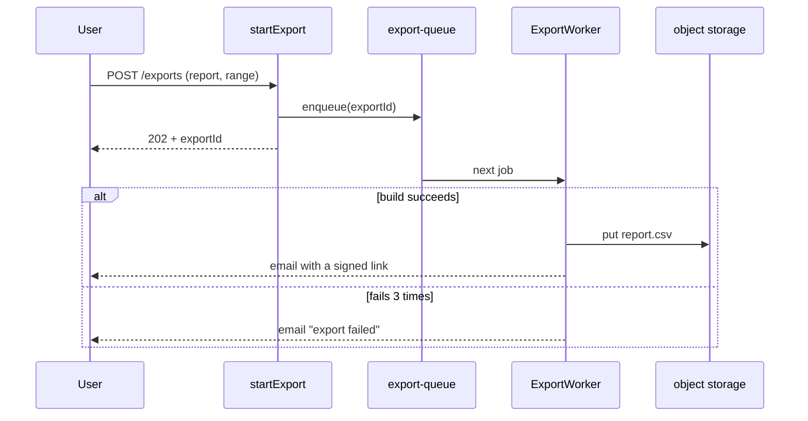

# Diagrams in documentation

A diagram earns its place when the prose for the same thing would be a paragraph the reader has to draw in their head: calls between components, a sequence with branches, states and their transitions, how data relates, where things run. A decorative diagram, or one that restates a single sentence, is noise.

## Format

- **Mermaid in the Markdown by default.** It renders on GitHub and GitLab, diffs as text and changes in the same commit as the code. Use the project's existing tool instead if it has one (PlantUML, D2, Structurizr).
- **Plain-text drawing** with box-drawing characters only where Mermaid won't render: code comments, CLI output, plain-text files.
- **Images** only when generated from a source committed next to them, with the command that regenerates them. Never a screenshot of a whiteboard as the only copy.

| To show | Use |
|---|---|
| Who calls whom, in order, with failures | `sequenceDiagram` (with `alt`/`opt` for branches) |
| Decisions and paths | `flowchart` |
| Lifecycle of an entity | `stateDiagram-v2` |
| Data and its relations | `erDiagram` |
| What runs where | `flowchart` with subgraphs per deployable or host |

## Rules

- **Show the real mechanism.** Name nodes and arrows as the code does, `startExport` and `ExportWorker` rather than "API" and "worker", so a reader can grep from the picture to the code. No invented layers.
- **One idea per diagram, at most about 12 nodes.** A bigger one splits by question: the happy path, then the failure paths.
- **Label every arrow** with what moves along it (the call, the message, the status code), and every branch with its condition.
- **Show failure paths** the reader will be paged for: rejections, retries, dead ends, and who gets alerted.
- **One sentence next to it states the takeaway** ("An export that fails three times is marked failed and the user is emailed; nothing retries after that."). The prose around it carries what the picture can't: limits, numbers, links to the code.
- **Same change as the code.** A diagram that no longer matches the code is a wrong doc; update or delete it with the change that broke it.

## Example

An export that fails three times is marked failed and the user is emailed; nothing retries after that.

Checking that diagrams render in CI: `checks.md`.
